# The web client

`casm serve` serves the web client at its own address (`http://localhost:7373`
by default). It's the primary way to use casm from a desktop or a phone: every
host, project and agent in one sidebar, chat with streaming transcripts,
queue and steer, permissions and questions, schedules, usage, settings and
file previews.

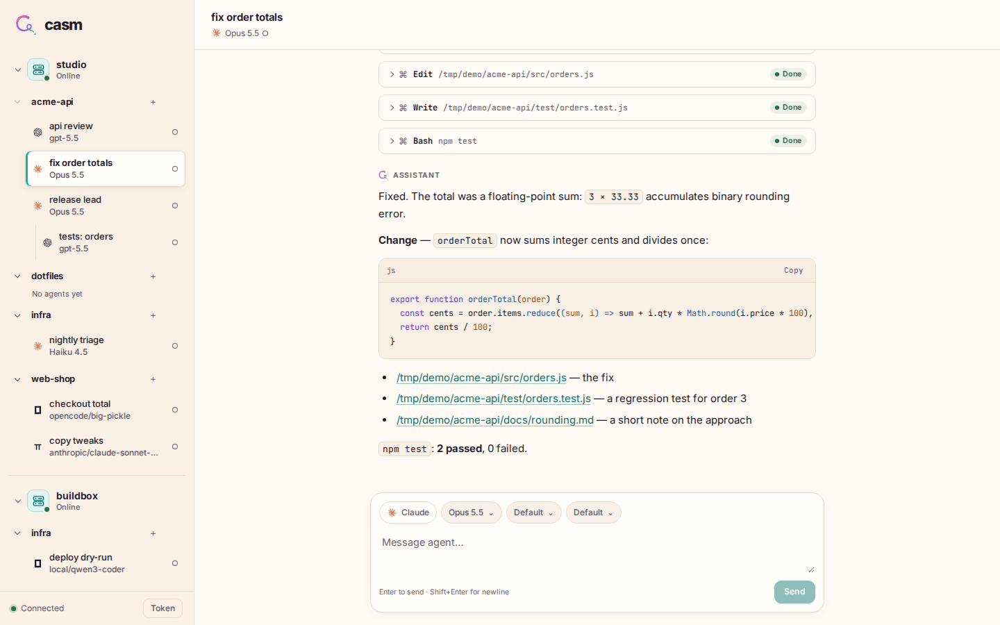

The screenshots on this page come from a demo server with fake providers
([`scripts/docs-media`](../scripts/docs-media/README.md)), so they show the
real UI with made-up projects.

## Connecting

1. On the server: `casm token create web` prints a token.
2. Open the server's address and paste the token into **Server token**, then
   **Connect**.

The token stays in the browser. The client connects to that one server; its
peers appear as further hosts in the sidebar, reached through it. To use it
from another device, make the server reachable over your own network (a VPN
such as Tailscale, or an HTTPS reverse proxy) with `listen` in
`$CASM_HOME/config.json`; the default `127.0.0.1` only accepts the machine
itself.

## Launcher: Cmd/Ctrl+K

Press **⌘K** on macOS or **Ctrl+K** on Windows/Linux to open the global launcher.
**⌘O / Ctrl+O** remains the browser's standard Open File shortcut.
The search buttons in the chat header and sidebar open the same launcher. On
phones it fills the screen and follows the keyboard's visible viewport.

Search agent names, projects, hosts, providers, or models. Matches are fuzzy,
with word-start/prefix boosts and highlighted characters. Results use the
already-loaded sidebar data across local and peer hosts: typing makes no server
requests. Each result is one line: the agent's provider icon and name, its
project and model, then the host (when there are several), status dot, queue and
subagent counts and last activity. The list is virtualized for large
workspaces. Cached host data remains searchable while disconnected; actions
requiring a server explain that they need a connection.

With an empty search the launcher is a short start page: agents needing
attention (waiting, failed, or a held queue), then running agents, then recently
opened ones; the most active projects; **New project** for the current host;
and **Schedules** for the current project (the open chat's or new-agent
draft's). Every other action appears once you type. Recent visits are
saved in this browser (up to 200 agents, keyed by host and agent). Search scores
take precedence when a query is entered, with recent visits breaking ties.
Results are grouped into Agents, Projects and Actions; the group with the
strongest match comes first.

- **↑ / ↓** or **Ctrl+P / Ctrl+N** moves through results.
- **Enter** opens the selected result. Agent navigation updates the URL, so Back works.
- **⌘Enter / Ctrl+Enter** starts a new-agent draft in the selected agent's
  project, or opens the selected project's options.
- **Tab / Shift+Tab** jumps between result groups.
- **Escape**, **Cancel** on phones, or a click outside the desktop panel closes it.

Enter on a project starts a new-agent draft there. Actions (each with its host
as secondary text) open **Find in chat** (with a chat open), **New project**, **Schedules**, **Host usage**, **Host
resources**, **Host AGENTS.md**, **System Prompt** and **Project options**. With no current project
on a host, its projects get one **Schedules: ‹project›** entry each. The existing settings dialogs retain
their own keyboard focus and unsaved edit guards; close them before opening the
launcher again. Theme continues to follow the system preference, so there is no
separate toggle action.

## The sidebar

Hosts, then their projects, then agents. Hosts are section headers (server
icon with a status dot, the name in small caps; hover for its status and how
many agents are working); projects are indented rows below them.
Each agent shows its provider icon,
model and status: idle (○), working, waiting for you, queued messages. Agents
other agents created are nested under their parent, also across hosts.

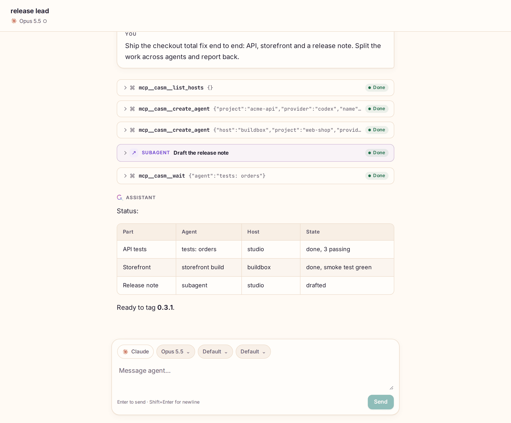

- **Host options** (⋯ next to a host) opens the host's window: Usage,
  Resources, AGENTS.md, System Prompt and Notifications.
- **Mini bars** (two thin bars before a host's chevron) show its CPU and RAM,
  filling from the bottom: amber from 80%, red from 95%. Hover for the numbers
  (`CPU 42% · RAM 6.5 of 16.0 GB`); click to open **Resources**. Every online
  host is read every 30 s (peers through their forwarding), paused while the
  page is hidden. Offline hosts and older hosts without `host.stats` show
  none; their space stays reserved, so the row never shifts.
- **New project** (+ next to a host) registers a folder on that host.
- **Project options** (⋯ next to a project) opens the project's window:
  AGENTS.md, Memories and Schedules, with the path (Copy), host and group under the
  title and **New agent** in its header.
- **+** next to a project starts a new agent in it.
- A project row folds or unfolds when clicked anywhere (› folded, ⌄ open); a
  host's chevron sits at the end of its header (‹ folded, ⌄ open). ⋯ always
  means options.

A new agent opens on a welcome screen: the project, its path and host, the
composer near the middle, and the keyboard shortcuts.

On a phone the sidebar is behind the **Agents** button.

  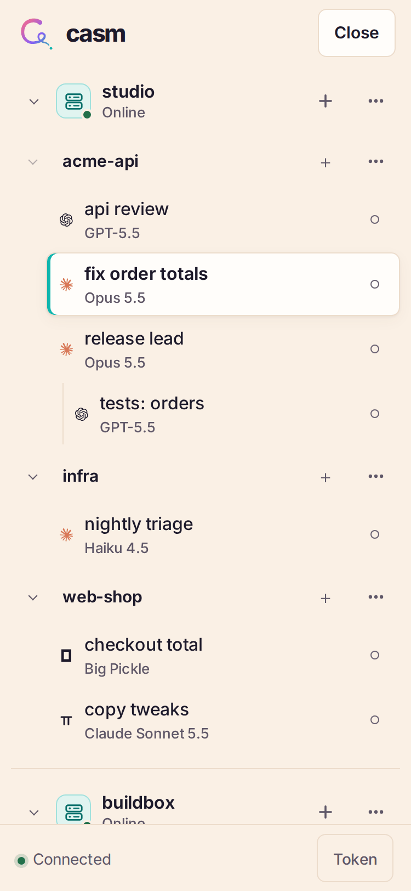
  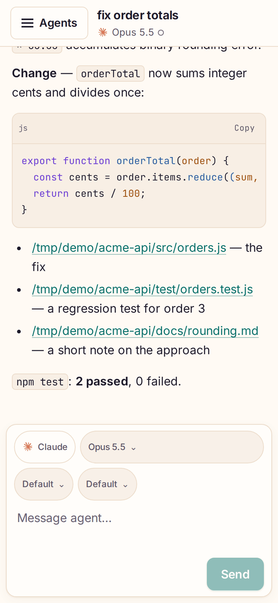
  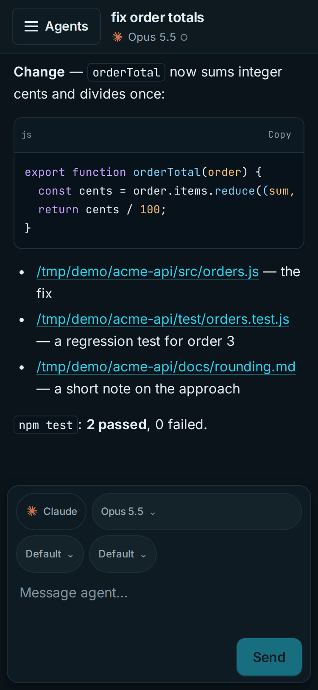

## Chatting

The transcript shows prompts, replies (Markdown with highlighted code), reasoning
(collapsed as **Thinking**), tool calls with their status, duration and
output, plans, subagents and notices. Long histories load as you scroll up;
while you're at the bottom, it follows new output.

The composer has pickers for the provider (new agents), model, mode and
effort. Attach images with the paperclip (on an iPhone: Photo Library, Take
Photo or Choose File), by pasting, or by dropping them on the composer; photos
over 2000px are scaled down, up to 10 images and 5 MB each. Type `/` for commands: casm's own
`/mcp`, `/reload`, `/restart` and `/interrupt`, then the provider's commands and
skills (see [MCP controls](mcp-controls.md#mcp-controls-and-composer-commands)).

While a turn runs, the composer offers three buttons:

| Button | Keys | What it does |
| --- | --- | --- |
| **Queue** | Enter | Adds the message to the agent's queue; it runs after the current turn. |
| **Steer** | Ctrl/⌘+Enter | Puts the message into the running turn. |
| **Interrupt** | | Stops the turn; the queue continues with its next message. |

## Find in chat

**⌘F / Ctrl+F** in an open chat opens a find bar over the top of the
transcript (on phones: the **Find in chat** button in the chat header, or
**Find in chat** in the launcher; there it sits above the composer, clear of
the keyboard). The browser's own find can't do this: the transcript loads in
pages and renders only the rows near the screen.

The search runs on the agent's host (`agent.find`) over the **whole**
history: sessions before a `/restart`, message text, Thinking, tool inputs and
outputs, subagents, plans and notices. It is a substring match, case-insensitive
unless the query has a capital letter. A filter narrows it to messages, tools
or Thinking.

- The bar counts **N of M** in time order and starts at the newest match.
  **Enter** (or ↑) goes to the next older match, **Shift+Enter** (or ↓) to the
  next newer one; both wrap around. Past 500 matches, the newest 500 can be
  stepped through.
- **Escape** or ✕ closes it and puts the focus back where it was.
- Matches are highlighted in place (amber; the current one solid), without
  changing the rows. A match inside a collapsed tool call, Thinking row,
  clamped text or long output opens it.
- A match in a part of the history that isn't loaded yet shows a **window**
  of about 100 entries around it, instead of loading everything in between.
  Scrolling up loads older pages there; scrolling down (or **Load newer
  messages**) loads newer ones until the window joins the live end. Meanwhile
  the chat doesn't follow new output: **Latest ↓** goes back to the end.

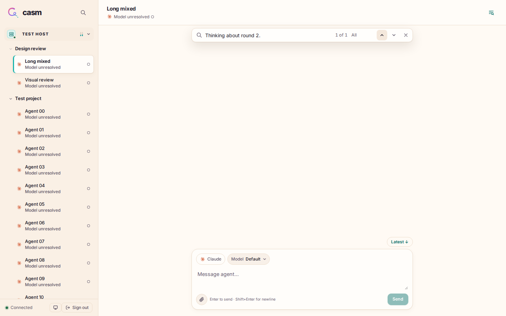

## The queue

Queued messages fold into a pill next to the working indicator (**2 queued**).
Open it for the queue panel: **Edit** a message in place, **Send now** (steer
it in, out of order), **Cancel** it, or **Retry now** for one that failed or
waits for a usage limit. A failed message stays at the front and holds the
queue, so nothing runs out of order. One that failed for a transient reason (a
server restart, a crashed agent process, an overloaded provider) shows
**Retrying in 1m 40s (attempt 2 of 3)** and goes again by itself; the pill
counts it as **retrying**. Otherwise it waits until you retry or cancel it
(see [the queue](concepts.md#messages-and-the-queue)). Drafts and queued messages from a
lost connection are kept and resent once.

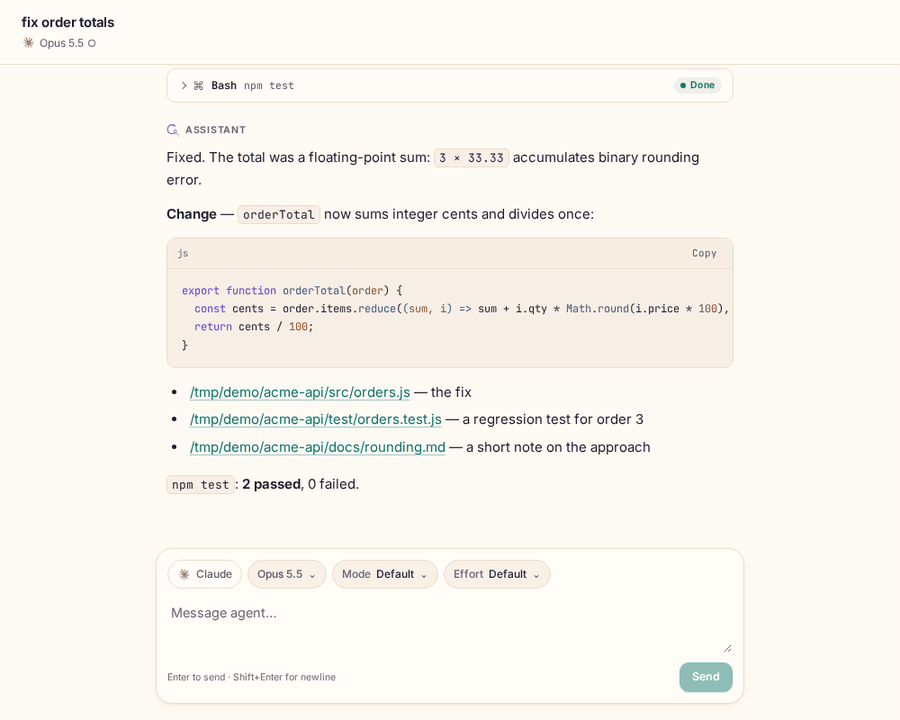

## Permissions and questions

When an agent asks to run a tool, a banner offers **Allow**, **Always allow**
(where the provider supports it) and **Deny**. Questions show as cards with
their options or a text field; **Answer** sends, **Dismiss** declines.
Both also work from the CLI and MCP; whichever answers first wins.

## Usage and limits

**Host options → Usage** lists each provider's subscription windows, how much
is used and when they reset. Beside them, every agent that prices its own calls
(OpenCode and pi) gets a card with its estimated cost per day for the last 7
days, summed over the host's casm agents: one bar per day, today highlighted,
the day's value above the chart on hover (or tap on a phone), and the 7-day
total. It is the agent's own estimate (its catalog price × tokens, not a bill;
free and local models count as $0), labelled "Estimated, as reported by
OpenCode". An agent with no cost in the window gets no card. The cards reload
with the tab and its Refresh button; screen readers get a summary and a table
of the days.

**Host options → Resources** (or a click on the host's mini bars) shows the
host's CPU %, load (1/5/15 min, amber when the 1-minute load exceeds the core
count), RAM and swap, refreshed every 10 s while the tab is open; it shares its
readings with the mini bars, so nothing is read twice. RAM is what is in use
beyond what could be freed without swapping (Linux `MemAvailable`; macOS free +
inactive + speculative pages). Per-agent context use and cost are in the CLI
(`casm usage`, `casm agents --usage`).

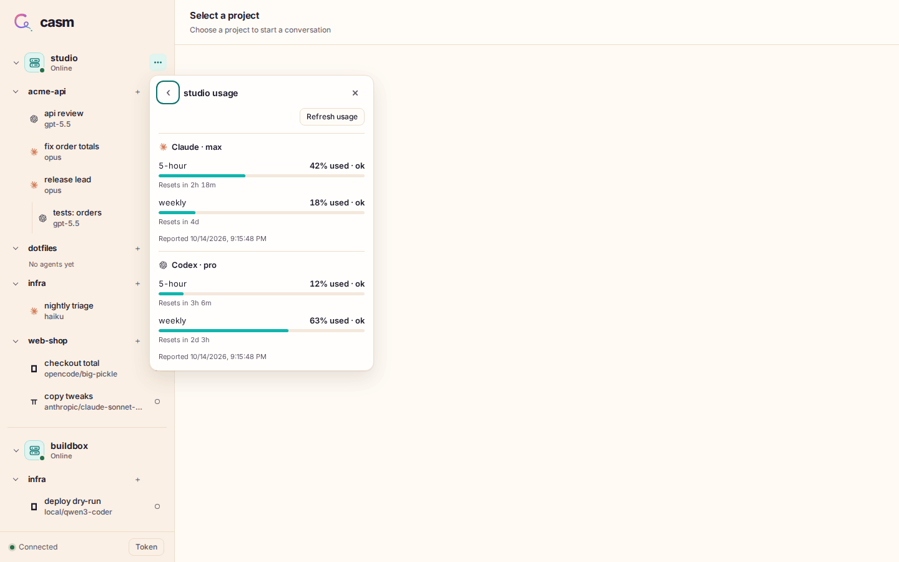

## Schedules

**Project options → Schedules** lists the project's schedules with their
cadence, target and next run. Each can be paused, run now or edited; **New
schedule** creates one: cron, every N minutes, or once, sent to one of the
project's agents (queue or skip when busy) or to a new agent started in the
project. **Schedules** in the launcher opens this tab for the current project.

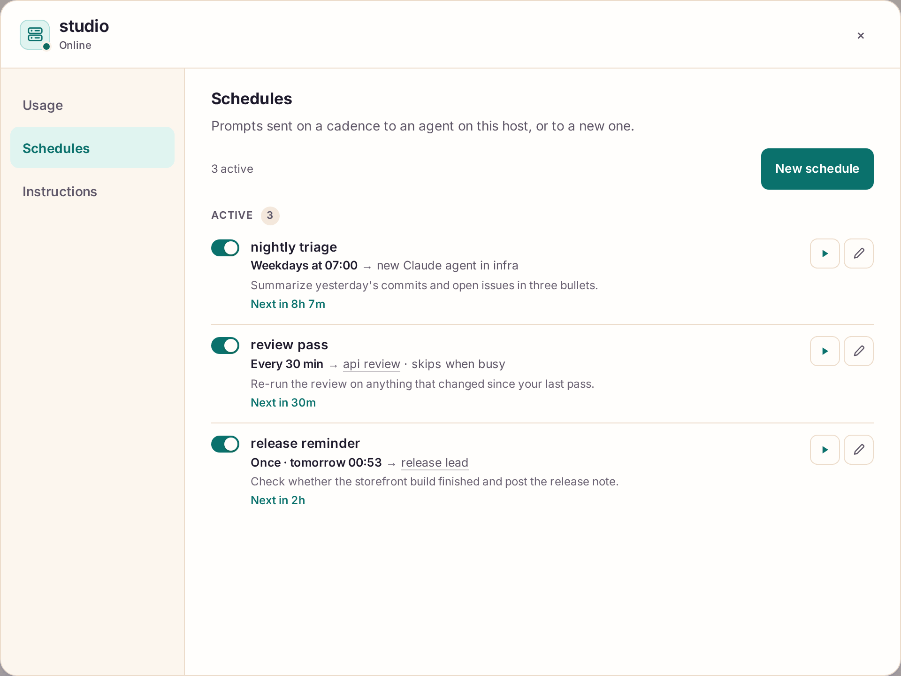

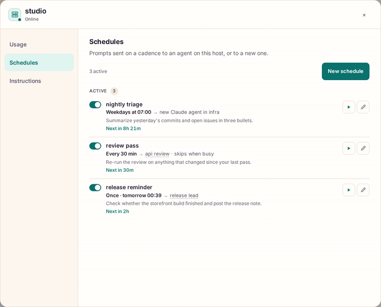

## Settings

**Host options → AGENTS.md** edits the host's global instruction files (the
`CLAUDE.md`/`AGENTS.md` each provider reads, with a conflict check).
**Host options → System Prompt** edits, previews, disables or resets casm's
[agent prompt](concepts.md#the-agent-prompt) (`casm agent-prompt` on the CLI).
Details: [host settings](host-settings.md).

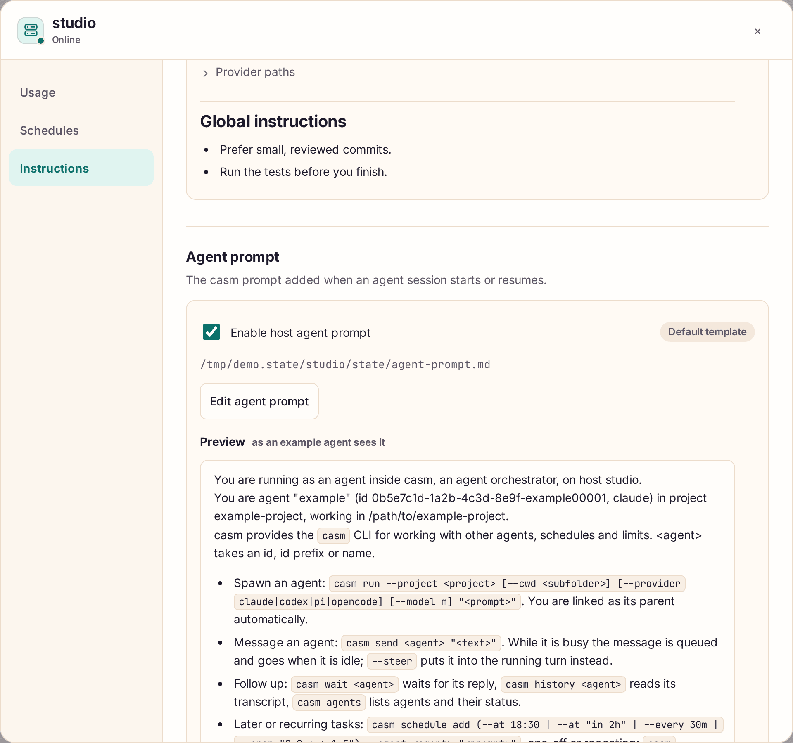

**Project options** does the same for one project: its `AGENTS.md`, its
providers' memories (read-only), its [schedules](#schedules), and its path,
group and agent count.

## Notifications

Agents notify you when you ask them to ("tell me when the deploy is done"):
they run [`casm notify`](cli.md#notifications), and every device you enabled
gets a system notification through Web Push, whether casm is focused, in the
background or closed. Clicking it opens the agent, in the open casm window if
there is one. On iPhone and iPad, whether a notification shows as a banner
while casm is in front is up to iOS; it lands in Notification Center either
way.

**Host options → Notifications** on the host serving the page:

- **Enable notifications** asks the browser for permission (it must come from
  a tap or click) and subscribes this device. The status says why it can't
  when it can't: plain HTTP (notifications need HTTPS or localhost), blocked
  in the browser or system settings, or an iPhone tab not on the Home Screen.
- **Send test notification** sends one to this device; **Turn off on this
  device** unsubscribes it.
- **Devices** lists every device subscribed on the host (with **Test** and
  **Remove**). A notification goes to all of them; `casm notify --device
  <name>` picks one.

On an **iPhone or iPad**, add casm to the Home Screen first (Safari, **Share →
Add to Home Screen**), open it from there, then enable notifications in its
host options. On a **Mac**, Safari tabs and **File → Add to Dock** apps both
can; enable them in the app you want them in. Chrome, Edge and Firefox work in
a tab. All of them need HTTPS, e.g. `tailscale serve` in front of casm.

Web Push is a standard: the browser gives casm an endpoint at its push service
(Apple, Google, Mozilla or Microsoft) and casm posts the notification there,
encrypted for that device. Unread notifications count on the app's icon badge
where the system supports it; opening casm clears it. A peer's agents notify
the devices subscribed on that peer, so enable notifications on each host's
own web client if you use several.

## New project

**New project** (+ next to a host) registers an existing folder on that host, with
folder completion as you type, a name, a group and tags.

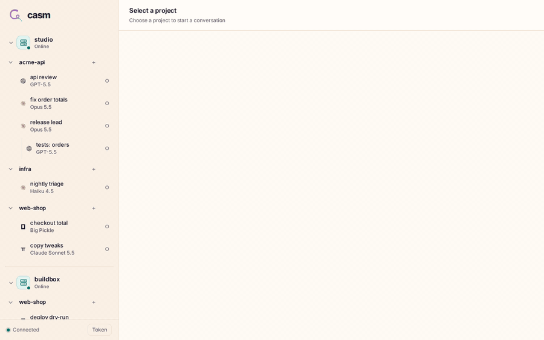

## Files

Paths that agents mention inside a project folder become links. Clicking one
opens a preview: syntax-highlighted code, rendered Markdown, pretty JSON,
images, with **Download** and **Copy path**. `/f/<absolute path>` opens a
preview directly. Files are read-only through casm.

Images attached to messages or tool output open in that same preview (click or
press Enter). Images fit by default; click or pinch to zoom to natural pixels
and drag to pan. A floating control under the image switches **Fit / 1:1** and,
for several images in the same message or tool row, steps between them (or use
**← / →**). On mobile, swipe down while fitted to close. **Download** saves
inline images with a tool/message name and timestamp; **Copy image** appears
where the browser supports image clipboard writes.

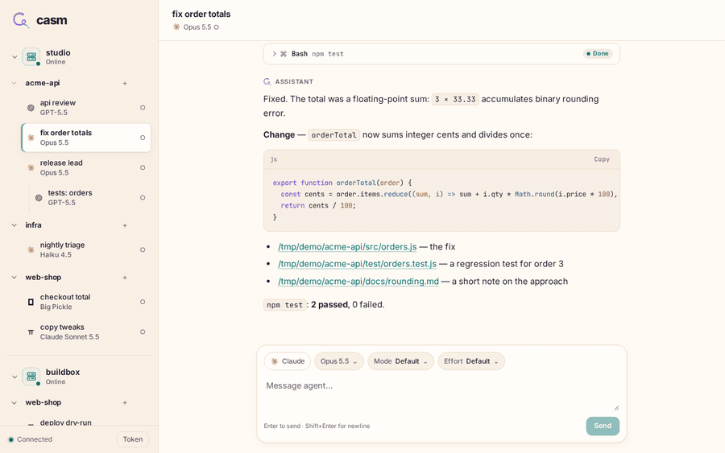

## Addresses you can share

Every view has its own URL, so you can bookmark or share them between your
devices:

- `/h/<host>/a/<agent-id>`: an agent
- `/h/<host>/p/<project-id>/new`: a new agent in a project
- `/f/<absolute path>`: a file preview

## Install as an app (PWA)

The web client installs as an app with its own window and the casm icon:

- **iPhone:** in Safari, **Share → Add to Home Screen** (keep **Open as Web
  App** on if shown).
- **macOS:** in Safari, **File → Add to Dock**.
- **Chrome / Edge:** the install button in the address bar (or the browser
  menu's install item).

Safari's Home Screen and Dock apps also work with a plain HTTP address. On
HTTPS or localhost the app shell is cached so the app starts offline (see
[Offline and connection](#offline-and-connection)); the service worker never
caches API responses, WebSockets or downloads. The
[README](../README.md#install-as-an-app) has the details and [pwa.md](pwa.md)
the implementation decisions.

## Offline and connection

The client never shows an old view as if it were live. Whenever it isn't
connected, or has just reconnected and is still fetching, a banner under the
header says so and how old the view is:

- **Reconnecting… · showing saved copy from 14:32**: the server can't be
  reached (or is being reached again).
- **Offline · saved copy from 14:32**: the device has no network.
- **Checking connection…**: the page came back after a long quiet spell and
  the client is confirming the connection.

The banner goes away once the sidebar and the open chat have been fetched
again; other chats refresh when you open them.

**Noticing a dead connection.** A laptop that slept or a phone app left in the
background can keep a connection that looks open but is dead. The client
checks it whenever the page becomes visible again, gets focus, is restored
from the back/forward cache, or the network changes, and also every 20
seconds of silence; a check that gets no answer (5 seconds after a resume, 10
otherwise) drops the connection and reconnects at once.

**The saved copy.** The client keeps, per browser, a copy of the sidebar
(hosts, projects, agents with their status) and the transcripts of the 50
agents opened most recently (their last 200 items each, about 50 MB at most).
Image data isn't saved and very long tool output is cut short. It lives in the
browser's IndexedDB, which also works on a plain-HTTP address. Starting the app
or coming back to it shows the saved copy for the last address at once, then
replaces it with the server's version (the same items are never shown twice).
Signing out (**Sign out** in the sidebar, after a confirmation) or connecting with a different
token deletes the copy.

**What works while disconnected.** Reading: the sidebar and the saved chats.
A chat that was never opened on this device shows **Not available offline**.
You can keep typing drafts; they're saved on the device and can be sent once
you're back. Everything that needs the server is disabled until then, with a
tooltip saying why: sending, steering and interrupting, **New agent**, **New
project**, queued-message actions (**Send now**, **Retry now**, **Edit**,
**Cancel**), permission and question answers, and schedule and settings
changes.

**HTTP and HTTPS.** Everything above works on a plain-HTTP address too:
installing the app, the saved copy, the connection banner, drafts, copying
code. Only the service worker needs HTTPS (or localhost), and two things depend
on it: a cold start with no connection at all (the app no longer in memory),
which on HTTP needs the server to load the app; and notifications. Whether to
serve casm over HTTPS (for example with `tailscale serve` or a reverse proxy) is
your network's choice. On HTTP the host options of the serving host say so in
one line; nothing else changes.

## Dark mode

The client follows your system's light/dark setting.

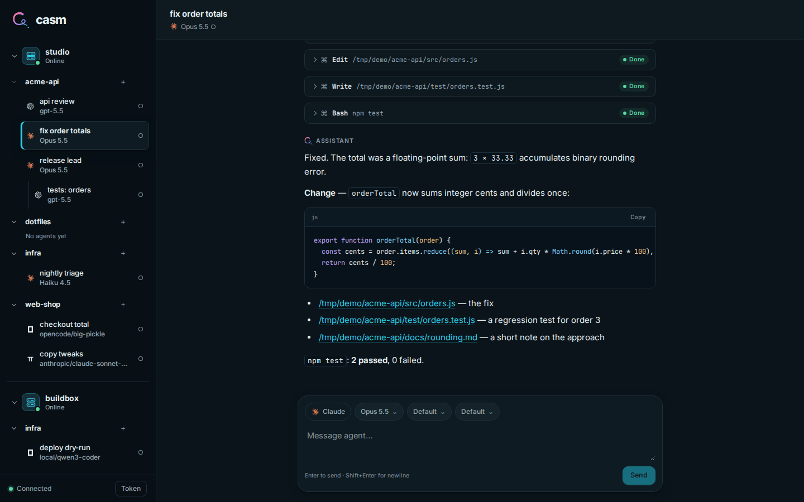
