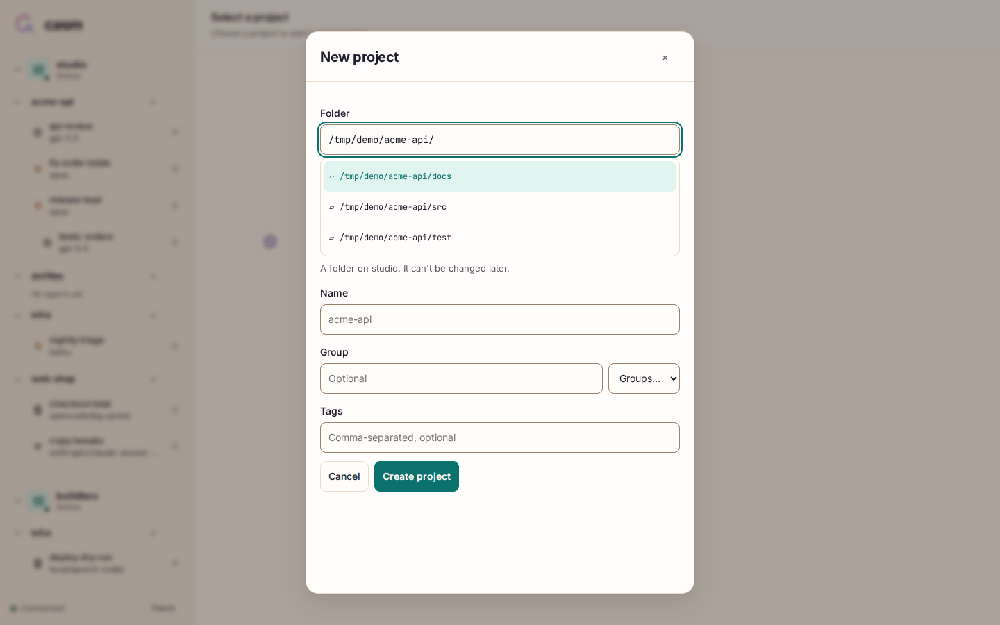
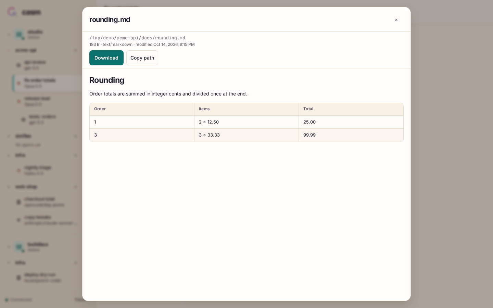

# The web client

`casm serve` serves the web client at its own address (`http://localhost:7373`
by default). It's the primary way to use casm from a desktop or a phone: every
host, project and agent in one sidebar, chat with streaming transcripts,
queue and steer, permissions and questions, schedules, usage, settings and
file previews.

The screenshots on this page come from a demo server with fake providers
([`scripts/docs-media`](../scripts/docs-media/README.md)), so they show the
real UI with made-up projects.

## Connecting

1. On the server: `casm token create web` prints a token.
2. Open the server's address and paste the token into **Server token**, then
   **Connect**.

The token stays in the browser. The client connects to that one server; its
peers appear as further hosts in the sidebar, reached through it. To use it
from another device, make the server reachable over your own network (a VPN
such as Tailscale, or an HTTPS reverse proxy) with `listen` in
`$CASM_HOME/config.json`; the default `127.0.0.1` only accepts the machine
itself.

## The sidebar

Hosts, then their projects, then agents. Each agent shows its provider icon,
model and status: idle (○), working, waiting for you, queued messages. Agents
other agents created are nested under their parent, also across hosts.

- **Host options** (⋯ next to a host) opens the host's window: Usage,
  Schedules and Instructions.
- **New project** (+ next to a host) registers a folder on that host.
- **Project options** (⋯ next to a project) opens the project's window:
  AGENTS.md, Memories and Info (with **New agent here**).
- **+** next to a project starts a new agent in it.
- A chevron only folds or unfolds; ⋯ always means options.

On a phone the sidebar is behind the **Agents** button.

  
  
  

## Chatting

The transcript shows prompts, replies (Markdown with highlighted code), reasoning
(collapsed as **Thinking**), tool calls with their status, duration and
output, plans, subagents and notices. Long histories load as you scroll up;
while you're at the bottom, it follows new output.

The composer has pickers for the provider (new agents), model, mode and
effort. Paste images to attach them. Type `/` for commands: casm's own
`/mcp`, `/reload`, `/restart` and `/interrupt`, then the provider's commands and
skills (see [MCP controls](mcp-controls.md#mcp-controls-and-composer-commands)).

While a turn runs, the composer offers three buttons:

| Button | Keys | What it does |
| --- | --- | --- |
| **Queue** | Enter | Adds the message to the agent's queue; it runs after the current turn. |
| **Steer** | Ctrl/⌘+Enter | Puts the message into the running turn. |
| **Interrupt** | | Stops the turn; the queue continues with its next message. |

## The queue

Queued messages fold into a chip above the composer (**2 queued**). Open it to
**Edit** a message in place, **Send now** (steer it in, out of order),
**Cancel** it, or **Retry now** for one that failed or waits for a usage limit.
A failed message stays at the front and holds the queue until you retry or
cancel it, so nothing runs out of order. Drafts and queued messages from a
lost connection are kept and resent once.

## Permissions and questions

When an agent asks to run a tool, a banner offers **Allow**, **Always allow**
(where the provider supports it) and **Deny**. Questions show as cards with
their options or a text field; **Answer** sends, **Dismiss** declines.
Both also work from the CLI and MCP; whichever answers first wins.

## Usage and limits

**Host options → Usage** shows each provider's subscription windows, how much
is used and when they reset. Per-agent context use and cost are in the CLI
(`casm usage`, `casm agents --usage`).

## Schedules

**Host options → Schedules** lists the host's schedules with their cadence,
target and next run. Each can be paused, run now or edited; **New schedule**
creates one: cron, every N minutes, or once, sent to an existing agent (queue
or skip when busy) or to a new agent made from a preset.

## Settings

**Host options → Instructions** edits the host's global instruction files (the
`CLAUDE.md`/`AGENTS.md` each provider reads, with a conflict check) and edits,
previews, disables or resets the [agent prompt](concepts.md#the-agent-prompt).
Details: [host settings](host-settings.md).

**Project options** does the same for one project: its `AGENTS.md`, its
providers' memories (read-only), and its path, group and agent count.

## New project

**New project** (+ next to a host) registers an existing folder on that host, with
folder completion as you type, a name, a group and tags.

## Files

Paths that agents mention inside a project folder become links. Clicking one
opens a preview: syntax-highlighted code, rendered Markdown, pretty JSON,
images, with **Download** and **Copy path**. `/f/<absolute path>` opens a
preview directly. Files are read-only through casm.

## Addresses you can share

Every view has its own URL, so you can bookmark or share them between your
devices:

- `/h/<host>/a/<agent-id>`: an agent
- `/h/<host>/p/<project-id>/new`: a new agent in a project
- `/f/<absolute path>`: a file preview

## Install as an app (PWA)

The web client installs as an app with its own window and the casm icon:

- **iPhone:** in Safari, **Share → Add to Home Screen** (keep **Open as Web
  App** on if shown).
- **macOS:** in Safari, **File → Add to Dock**.
- **Chrome / Edge:** the install button in the address bar. This needs
  **HTTPS** (or `localhost` on the server machine), for example through
  `tailscale serve` or a reverse proxy with a certificate.

Safari's Home Screen and Dock apps also work with a plain HTTP address. On
HTTPS or localhost the app shell is cached so the app starts offline;
connecting to agents still needs the server, and API responses, WebSockets and
downloads are never cached. The [README](../README.md#install-as-an-app) has
the details and [pwa.md](pwa.md) the implementation decisions.

## Dark mode

The client follows your system's light/dark setting.

